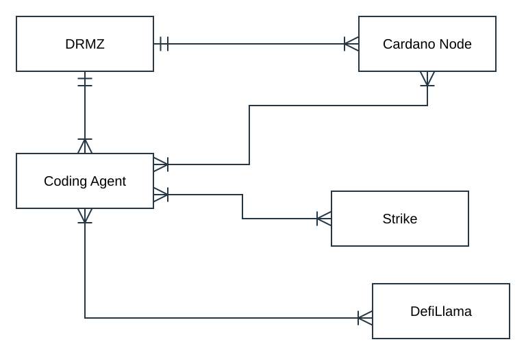

# Paper Hands — Entity Relationships

## Model and source

This is the existing draw.io XML diagram, displayed below through an SVG preview generated from its node geometry, connectors, labels, and cardinality styles. The editable XML source remains [DRMZ-Agent-Relationships.drawio](docs/DRMZ-Agent-Relationships.drawio).

The XML is the source of truth. Preserve its five entities, five connections, positions, and crow's-foot markers. Relationship labels remain blank, as in the original. Regenerate the preview when the XML changes.

## Diagram

[Open the diagram preview](docs/DRMZ-Agent-Relationships.svg) · [Open the editable draw.io XML](docs/DRMZ-Agent-Relationships.drawio)

## Entities

| Entity in the diagram | Interpretation in this product's context |
| --- | --- |
| DRMZ | The organization and community supplying the product purpose, educational context, and host website. |
| Coding Agent | Development and research tooling that uses the repository and relevant data sources. |
| Cardano Node | Infrastructure for blockchain observations and research verification. |
| Strike | The intended source of public market observations for the educational trading experience. |
| DefiLlama | An external source used for comparative protocol research and metrics. |

The coding agent is distinct from Morpheus, the learner-facing guide described in [Product.md](Product.md) and [design.md](design.md). The diagram does not make the coding agent an autonomous trading service.

## Relationship cardinalities

| Source connection | Cardinality shown in the source |
| --- | --- |
| DRMZ → Coding Agent | One-to-many |
| DRMZ → Cardano Node | One-to-many |
| Coding Agent ↔ Strike | Many-to-many |
| Coding Agent ↔ Cardano Node | Many-to-many |
| Coding Agent ↔ DefiLlama | Many-to-many |

The crow's-foot markers come from the XML's endpoint styles. These are conceptual model markings, not verified deployment counts or requirements for multiple live providers. Specific relationship verbs and operational multiplicities remain to be confirmed before using this model to constrain implementation.

## Scope and implementation use

This diagram describes ecosystem relationships. It does not define database tables, primary keys, foreign keys, or a learner-account schema. No such attributes have been added to the source model.

A learner does not need to operate a Cardano node to use the web app. Node and DefiLlama relationships describe research context; their presence does not require those services in every practice-trade request. Strike observations and virtual execution remain separate, as described in [Product.md](Product.md), [requirements.md](requirements.md), and the [trade workflow](README.md#trade-architecture-and-workflow).

Use [docs/metrics.md](docs/metrics.md) for the existing research snapshot and its provenance. A future persistence model should explicitly address saved progress, accounts, positions, journal records, and learning awards when those implementation decisions are made; it should not be inferred from this ecosystem diagram.
