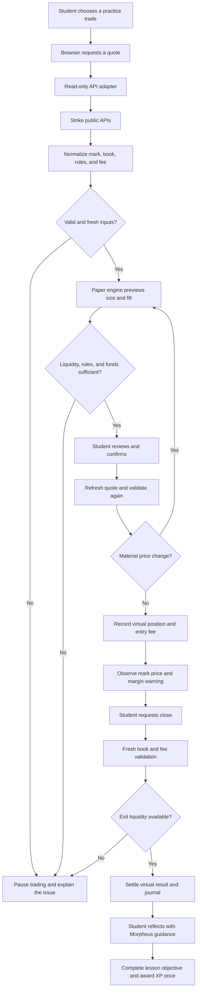

# Paper Hands

A proposed DRMZ educational web app where beginners learn perpetuals through virtual trading, contextual Morpheus guidance, and XP for demonstrated understanding. The target is a responsive progressive web app for laptop and phone, with a guided first task that introduces tools gradually.

## Documentation

| Document | Purpose |
| --- | --- |
| [Product.md](Product.md) | Business concept, mission, problem, solution, and value proposition. |
| [design.md](design.md) | Website-derived colors, typography, layout, shapes, and component guidance; observed styles are distinguished from app adaptations. |
| [requirements.md](requirements.md) | User and system requirements with acceptance criteria. |
| [ER.md](ER.md) | The existing conceptual entity relationship diagram and its editable source. |
| [docs/backlog.md](docs/backlog.md) | Prioritized implementation work and status. |
| [docs/metrics.md](docs/metrics.md) | Dated Strike ecosystem research and verification context. |

The product and design documents describe the intended experience. Requirements define acceptance, and the backlog tracks delivery. Follow [AGENTS.md](AGENTS.md) when implementing changes.

## Trade Architecture and Workflow

The user interface gathers the student's decision. The read-only adapter fetches provider data. The deterministic paper engine calculates and validates virtual execution. The local account ledger records the result. Morpheus explains the mechanism; it does not replace the calculation engine. The following diagram is the intended live-observation workflow. The guided scenario described in [design.md](design.md) supplies explicitly fictional inputs instead of provider observations. The earlier skeleton and reference source are not present in this repository.

The initial engine is intended to be browser-local, with no server-side user account or funds custody. An agent can read this brief and call public data routes, but automated paper order APIs, account sync, and autonomous trading agents are separate future capabilities. Installation of a skill file alone does not create them.

See [LICENSE](LICENSE) for terms.
