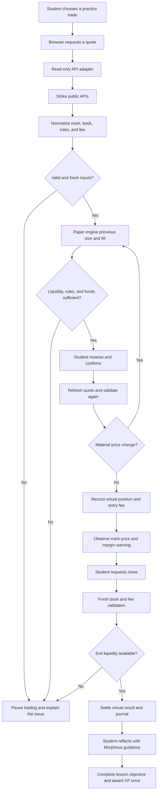

# Paper Hands

A proposed DRMZ educational web app where beginners learn perpetuals through virtual trading, contextual Morpheus guidance, and XP for demonstrated understanding. The target is a responsive progressive web app for laptop and phone, with a guided first task that introduces tools gradually.

## Trade Architecture and Workflow

The user interface gathers the student's decision. The read-only adapter fetches provider data. The deterministic paper engine calculates and validates virtual execution. The local account ledger records the result. Morpheus explains the mechanism; it does not replace the calculation engine. The following diagram is the intended live-observation workflow, not the skeleton's network behavior. In `skeleton-ui/`, an explicitly fictional scenario supplies the quote locally; the rest of the first-trade loop uses the shared deterministic engine.

The initial engine is browser-local, with no server-side user account or funds custody. An agent can read this brief and call public data routes, but automated paper order APIs, account sync, and autonomous trading agents are separate future capabilities. Installation of a skill file alone does not create them.

See [LICENSE](LICENSE) for terms.
