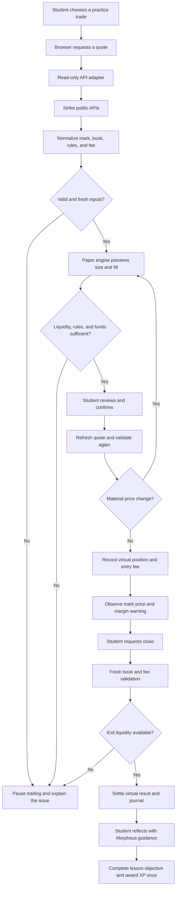

# DRMZ Paper Hands — Design and Product Direction

## Overview

Paper Hands is a proposed DRMZ learning experience: a responsive progressive web app where students learn perpetual trading concepts, practice with virtual funds, and earn XP for demonstrating understanding. Morpheus is the learning guide. Strike is the intended source of market data. DRMZ supplies the educational purpose, community, and visual identity.

The experience should feel thoughtful, welcoming, and exploratory. Pair DRMZ's navy, lavender, and gold identity with clear explanations and calm interaction. A beginner should understand the next step without already knowing exchange terminology. Use the brand line **Dream. Learn. Earn.** In this product, “earn” means learning XP unless a separately specified reward program explicitly says otherwise.

### Status and evidence

**Publication scope — documents only (2026-10-23):** The user deferred the video and requested text documents. This commit publishes the business/design/requirements brief and supporting Markdown. The guided UI, earlier technical prototype source, scripts, tests, images, and video remain local and are not included. References to implementation paths below describe prepared work and intended locations. Backlog statuses marked “Implemented” refer to that local work, not source published in this commit. A coding agent must obtain or implement the source and rerun its checks before relying on it.

This is a proposed product design, not a claim that DRMZ has already shipped this paper trading app. The previously prepared concept video uses illustrative data and interface mockups; its upload is deferred. It does not demonstrate a working Strike connection, executable simulator, or deployed PWA.

| Source | What is established | What remains a proposal |
| --- | --- | --- |
| [drmz.app](https://www.drmz.app/) | DRMZ's education and onboarding mission, MorpheusAI, and the brand line | This paper trading curriculum and app |
| [DRMZ logo artwork](https://github.com/rodg-drmz/web3ie-media-assets/blob/main/Web3%20In%20Education%20Courses/AI%20Demystified%20Course/DRMZNEW24.png) | Opaque logo pixels include navy #0E1A34, lavender #B9AFD6, and gold #FCEBA9 | Semantic UI roles and supporting colors |
| [DRMZ Cardano artwork](https://github.com/rodg-drmz/web3ie-media-assets/blob/main/Web3%20In%20Education%20Courses/AI%20Demystified%20Course/DRMZ%20-14.png) | A published Cardano graphic in dark blue #1A2239 | Its placement in this app |
| [Google Labs DESIGN.md specification](https://github.com/google-labs-code/design.md/blob/main/docs/spec.md) | Document structure, YAML token groups, and token references | This document's product decisions |
| [Strike integration resources](https://github.com/strike-finance/strike-finance-skills) | Reference material for market data and trading calculations | Integration, availability checks, and simulator fidelity |

Reviewed 2026-10-23. Website text and public creator assets were available; direct site image downloads and the live stylesheet were not. Therefore this is an asset-grounded DRMZ adaptation, not an exact extraction of drmz.app's CSS or typography. The three logo colors are sampled; other tokens and font choices are proposed product extensions. Reconcile against the live stylesheet when accessible.

### Business Concept

**Primary audience:** students and other beginners who want to understand perpetuals before deciding whether they ever want to trade with real money. Prior wallet ownership, crypto deposits, or trading experience should not be prerequisites.

### Mission Statement

Help students build the understanding and judgment to explore decentralized finance with curiosity, confidence, and care—through accessible practice, clear explanations, and evidence of learning.

### Problem / Solution Statement & Value Proposition

**Problem statement:** A beginner needs a way to connect unfamiliar trading concepts to observable consequences. Reading a definition of leverage or funding does not by itself show how a position changes. Practicing directly with real funds makes early mistakes financially consequential. The working hypothesis is that short explanations, guided simulation, and feedback can make these concepts easier to understand and retain. This hypothesis needs testing with learners.

**Proposed solution:** Build a browser-accessible learning environment that combines market observations from Strike with a clearly separated virtual account. Morpheus explains concepts and helps students reflect on their decisions. Short exercises isolate specific mechanisms. XP recognizes completed learning objectives and demonstrated understanding.

**What DRMZ is building:** Paper Hands, an educational paper trading PWA under the DRMZ brand. The initial product joins a lesson library, a virtual trading workspace, a Morpheus guide, a practice journal, and an XP record. It adapts to laptop and phone layouts. Installation is optional; the core experience is available through a website.

| Participant | Need | Proposed value |
| --- | --- | --- |
| Student | Learn what a trade means and explain its consequences | Guided practice without committing real funds |
| DRMZ | Make its education mission tangible and repeatable | A reusable learning resource and a path into its community |
| Educator or workshop host | Teach concrete mechanisms and identify misconceptions | Reusable exercises with clear completion criteria |
| Strike ecosystem | Help people understand its market mechanics | Informed exploration of documented market data, without a promise of conversion to live trading |

**Value proposition:** Students can connect concepts to consequences without committing real funds; educators gain repeatable exercises; DRMZ gains a mission-aligned learning resource; Strike gains an informed route into understanding its market mechanics. Progress measures explanation and judgment, not speculative profit.

**Sustainability hypothesis:** Explore education sponsorships, grants, and workshop or curriculum partnerships. Validate who funds hosting, data access, AI inference, and curriculum maintenance. No revenue model, partner agreement, or funding commitment is assumed. Trading profits, student deposits, scholarship payouts, and stake-pool returns are not dependencies of the initial product.

**Success measures:** Observe whether students can explain price exposure, direction, margin, funding, and liquidation after practice. Track lesson completion, corrected misconceptions, delayed recall, and time to complete a first guided exercise. Aggregate analytics should minimize personal data collection. Profit, leverage used, time spent trading, and number of orders are not measures of learning success.

**Open questions:** Which concept most often blocks beginners? How accurate must execution simulation be for each lesson? What data history is available? Who reviews curriculum and funds operation? What does a student understand a week later? Answer these with a small learner pilot before expanding scope.

### Initial learning journey

**Latest product decision — progressive discovery:** The dashboard-first prototype exposes too much before a beginner knows what to do. The default entry experience must introduce one concept and one meaningful action at a time, inside the task itself. The inspiration is the user's description of Gobi's gradual introduction of features; this is a design principle, not a claim of feature parity or a reproduction of its interface. Avoid a separate account-creation flow or a lengthy product tour. Let the learner start practicing immediately.

The first exercise is: meet Morpheus, choose a market, choose long or short, choose a small virtual margin at fixed 1× leverage, review, open, explore a price change, close, explain the result, and receive learning XP. Reveal tools when they become useful. Introduce leverage, funding, order types, the lesson library, and the full practice workspace in subsequent lessons. A complete dashboard is a later destination, not the opening screen.

| Moment | Introduce now | Introduce later |
| --- | --- | --- |
| First visit | One invitation to try; Morpheus; virtual-only status; theme toggle | Balance dashboard, chart tools, lesson catalog, journal |
| Choose market | Two simple illustrative choices in the skeleton; verified market list in the live-data experience | Depth panels and multiple market statistics |
| Choose direction | Long and short explained in context | Strategy presets and multi-leg trades |
| Choose size | Virtual margin and available balance; fixed 1× for the first exercise | Leverage slider, margin tiers, liquidation lesson |
| Review | Direction, actual quantity, exposure, margin, illustrative or verified fees, and source | Advanced order controls |
| Open position | Price movement, labeled price P&L, and close action | Funding settlement and risk scenarios |
| Close and reflect | Fees, wallet result, misconception feedback, and objective check | Full journal browsing and export |
| Complete | XP once, practice record, next learning objective | Optional identity and sync |

**UX acceptance:** A first-time learner can identify the next action without a trading glossary or educator intervention. No account, wallet connection, or deposit blocks the exercise. Each step explains the term it introduces. Back navigation before confirmation preserves choices without placing a trade. The user reviews before any virtual position opens. Journal and advanced controls do not compete with the first task. Evaluate this in a novice usability session; model tests alone cannot prove discoverability.

Offer local persistence with a clear explanation of what is stored. Guest progress remains on the current device; clearing site data can remove it. Continuity across devices requires an explicitly designed sync mechanism and must not be implied automatically.

| Lesson | Demonstrated outcome | Proposed completion XP |
| --- | --- | ---: |
| What am I trading? | Distinguish contract exposure from asset ownership | 50 |
| Long or short? | Explain how direction affects price profit and loss | 50 |
| My money versus my position | Distinguish margin, leverage, and position size | 50 |
| Why did my position close? | Explain maintenance requirements and liquidation | 50 |
| Where did the money go? | Separate price changes, fees, and funding | 50 |
| How do I enter and exit? | Choose an order type and describe its limitations | 50 |
| Make a practice plan | Set a size, loss budget, and exit condition | 50 |
| Complete the trading loop | Place, monitor, close, and explain a virtual position | 100 |

XP values are provisional. Award once for completing the stated objective for a lesson version; allow supportive retries. Reading a page alone is insufficient evidence of understanding. A virtual loss can accompany an excellent explanation and still earn full lesson XP. Do not reward larger bets, more trades, or repeated resets.

### Product boundaries

All practice orders and balances are virtual. Live data is observational; simulation is a separate product function. Public market data access does not create virtual balances or provide simulated fills automatically. Morpheus may explain and prepare a virtual action, with the student making the meaningful practice decision. Learning does not require authorizing a real-money trade.

The first release excludes deposits, withdrawals, automatic live trading, copy trading, scholarship administration, and bounty payments. Real-money activity would require a separately designed product flow and user authorization. A profitable simulation does not establish a viable live trading strategy.

## Colors

Provide two equal product themes: **Dark** for a navy workspace and **Light** for a pale lavender workspace. Dark remains the default promotional-video theme. Both themes preserve the same DRMZ artwork, gold learning actions, layout, content, and functionality. **DRMZ Navy** is the page background; **DRMZ Lavender** identifies navigation and instructional emphasis; **DRMZ Gold** identifies the main learning action and XP milestones. Reserve green and rose for labeled result or validation states. Do not use direction, profit, or loss colors as decorative confetti.

The logo colors below are sampled from published artwork. Surface layers, muted text, focus, and semantic states are proposed extensions chosen for readable interfaces. Tokens are normative for this proposed product. Do not replace them with approximate violet, beige, or electric cyan.

```yaml
colors:
  primary: "#B9AFD6"
  on-primary: "#0E1A34"
  secondary: "#FCEBA9"
  tertiary: "#9688BC"
  neutral: "#0E1A34"
  background: "#0E1A34"
  surface: "#1A2239"
  surface-raised: "#222D47"
  surface-selected: "#35304E"
  on-surface: "#F8F7FC"
  on-surface-muted: "#B8BFD0"
  on-accent: "#0E1A34"
  outline: "#5C6C8A"
  outline-subtle: "#34415D"
  focus: "#FCEBA9"
  success: "#9BD8BF"
  success-surface: "#213C36"
  error: "#F3A5B7"
  error-surface: "#482A3A"
  warning: "#FCEBA9"
  chart-reference: "#B8BFD0"
  light-primary: "#625080"
  light-on-primary: "#FFFFFF"
  light-secondary: "#FCEBA9"
  light-tertiary: "#9688BC"
  light-neutral: "#F7F5FA"
  light-background: "#F7F5FA"
  light-surface: "#FFFFFF"
  light-surface-raised: "#EEE9F5"
  light-surface-selected: "#E5DDEF"
  light-on-surface: "#0E1A34"
  light-on-surface-muted: "#555F73"
  light-on-accent: "#0E1A34"
  light-outline: "#7D7891"
  light-outline-subtle: "#D3CBDD"
  light-focus: "#625080"
  light-success: "#23684D"
  light-success-surface: "#E3F2E9"
  light-error: "#9F3653"
  light-error-surface: "#FBE9EE"
  light-warning: "#765814"
  light-chart-reference: "#666176"
```

Unprefixed color names form the dark theme; `light-` names override the corresponding semantic roles in the light theme. The light primary is an accessible darker lavender for text and controls; it does not recolor the logo. Bind both themes to the same CSS variable names under `data-theme="dark"` and `data-theme="light"`. Respect an explicit theme URL or stored preference, retain a visible toggle, and expose both themes at every breakpoint. Never use dark-theme text directly on light-theme surfaces.

Apply on-surface or on-surface-muted to their theme’s surfaces. Use on-accent for text on gold fills, and on-primary for text on a filled primary background. Gold text belongs on dark backgrounds. Use outline for actionable input boundaries; outline-subtle may separate noninteractive containers. Profit and loss must also have signs, words, or icons so that color is never the only signal. Show focus with a visible ring plus spacing from the component edge.

## Typography

Use a system sans-serif stack for the proposed PWA. This avoids a required font download and supports a lightweight first visit. The website's exact font family was not verified. Use a system monospace stack for compact market data where it improves alignment; use tabular figures for prices, balances, and XP.

Write short, plain-language headings and explain a new term where it first appears. Avoid all-caps paragraphs. Keep instructional body text at least 16px and essential annotations at least 12px; do not hide important simulation status in tiny footnotes. Promotional video typography may scale these roles to the output resolution while retaining the same hierarchy. The current concept renderer uses its installed Nimbus Sans and DejaVu Sans Mono as local fallbacks; this does not establish drmz.app's font family.

```yaml
typography:
  display:
    fontFamily: "system-ui, -apple-system, BlinkMacSystemFont, Segoe UI, sans-serif"
    fontSize: 56px
    fontWeight: 700
    lineHeight: 1.1
    letterSpacing: -0.02em
  headline-lg:
    fontFamily: "system-ui, -apple-system, BlinkMacSystemFont, Segoe UI, sans-serif"
    fontSize: 40px
    fontWeight: 700
    lineHeight: 1.15
  headline-md:
    fontFamily: "system-ui, -apple-system, BlinkMacSystemFont, Segoe UI, sans-serif"
    fontSize: 28px
    fontWeight: 700
    lineHeight: 1.25
  headline-sm:
    fontFamily: "system-ui, -apple-system, BlinkMacSystemFont, Segoe UI, sans-serif"
    fontSize: 22px
    fontWeight: 600
    lineHeight: 1.3
  body-lg:
    fontFamily: "system-ui, -apple-system, BlinkMacSystemFont, Segoe UI, sans-serif"
    fontSize: 18px
    fontWeight: 400
    lineHeight: 1.6
  body-md:
    fontFamily: "system-ui, -apple-system, BlinkMacSystemFont, Segoe UI, sans-serif"
    fontSize: 16px
    fontWeight: 400
    lineHeight: 1.5
  body-sm:
    fontFamily: "system-ui, -apple-system, BlinkMacSystemFont, Segoe UI, sans-serif"
    fontSize: 14px
    fontWeight: 400
    lineHeight: 1.5
  label:
    fontFamily: "system-ui, -apple-system, BlinkMacSystemFont, Segoe UI, sans-serif"
    fontSize: 14px
    fontWeight: 600
    lineHeight: 1.3
    letterSpacing: 0.02em
  caption:
    fontFamily: "system-ui, -apple-system, BlinkMacSystemFont, Segoe UI, sans-serif"
    fontSize: 12px
    fontWeight: 400
    lineHeight: 1.5
  data:
    fontFamily: "ui-monospace, SFMono-Regular, Consolas, monospace"
    fontSize: 16px
    fontWeight: 500
    lineHeight: 1.4
    fontFeature: '"tnum" 1'
```

## Layout

Build one responsive PWA, not separate desktop and mobile products. The same lesson objective, practice status, and controls remain available in both layouts. Website access is the default; optional installation must not block learning.

Use a fluid grid with a maximum content width of 1440px. The guided entry uses a focused lesson card and a secondary Morpheus panel; no persistent dashboard sidebar is needed. Below 768px, stack the active task and guidance in a single column with 16px outer padding. Between 768px and 1023px, allow two columns where readable. At 1024px and above, retain the focused task and optional guide. Persistent navigation belongs to the later practice workspace, introduced after the first exercise. Breakpoints are proposed layout decisions, not extracted website values.

Morpheus becomes an expandable panel or sheet on small screens. It must not obscure the active lesson, keyboard, or trade confirmation. Preserve touch targets of at least 44px, browser zoom, safe-area padding, and visible focus order. Lessons and controls should reflow at 320 CSS pixels; charts may use a contained pan region with a textual alternative.

```yaml
spacing:
  xs: 4px
  sm: 8px
  md: 16px
  lg: 24px
  xl: 32px
  xxl: 48px
  section: 64px
  page-mobile: 16px
  page-desktop: 32px
  gutter: 24px
  content-max: 1440px
  touch-min: 44px
```

### Market information and simulator states

Use labels for **Live**, **Delayed**, **Replay**, **Illustrative**, and **Offline**. Display the data source, observation timestamp, units, and relevant funding interval. Only label data live when freshness is actually monitored. When data becomes stale, pause dependent simulation actions or explicitly switch to a labeled replay; do not silently invent current prices.

Offline access may cache lesson text and saved local progress. A PWA label does not imply offline market feeds, automatic installation support on every browser, or cross-device synchronization. Specify those behaviors separately during implementation.

## Elevation & Depth

Use tonal separation: background, surface, then surface-raised. Prefer a quiet border to a large shadow. Sheets and dialogs may use a restrained shadow equivalent to 0 12px 40px rgba(0,0,0,0.28). A dialog backdrop should dim the workspace while leaving its context recognizable.

In video, keep the stage dark navy and use a small lavender glow behind devices at most. Avoid the cream promotional background from the prior draft. Distinguish laptop and phone hardware from the application with muted outlines and neutral metal, without changing the UI palette.

Use 180–240ms transitions for panels and feedback. Respect reduced-motion preferences. XP animation should be brief and optional; no flashing, forced streak anxiety, or celebratory effects tied to risky trades. The concept video may use gentle device movement and fades, with enough dwell time to read a headline.

## Shapes

Use rounded rectangles for cards, fields, and lesson panels. Use pills for compact state labels, not long paragraphs. Use circles for identity marks and small progress indicators. A consistent radius hierarchy should soften dense financial information without turning every element into a toy.

```yaml
rounded:
  sm: 8px
  md: 12px
  lg: 20px
  xl: 28px
  full: 9999px
```

### Brand assets and iconography

Use DRMZ's published logo and preserve its aspect ratio and colors. Keep clear space of at least one-quarter of the mark's height. Use the extracted circular snake-and-Cardano emblem as a brand mark only; it is not a verified portrait of Morpheus. The actual Morpheus avatar must be sourced and checked before being presented as his likeness. Keep asset provenance with the project.

Use the published Cardano graphic only for Cardano-related identity. Its dark blue may disappear on navy; place it on a contrasting lavender tile while leaving the graphic's pixels unchanged. Keep functional icons from one consistent line-icon family. Provide text labels for navigation and unfamiliar financial controls. Gobi is a flow reference, not an asset library or DRMZ mascot source.

## Components

**Navigation:** Use Learn, Practice, Journal, and Progress as clear destinations. Show Practice mode and virtual balance consistently. On phone, choose a compact navigation arrangement with labels and avoid hiding the lesson exit.

**Buttons and inputs:** Gold identifies the single main learning or practice action. Lavender supports secondary actions and selection. Dark text belongs on filled accent buttons. Inputs have persistent labels, helper text, units, error messages, and visible focus. Explain leverage as position size relative to supporting margin rather than an unexplained multiplier.

**Lesson card:** Include a plain-language objective, approximate duration, completion criteria, and XP. Use an explanation, prediction, action, and reflection sequence. Distinguish completed, available, and locked states with text as well as styling.

**Morpheus panel:** Identify it as an AI learning guide. Keep the student's question visible, use concise explanations, and offer optional hints. Retrieve facts and deterministic calculations from documented sources or simulator state; do not invent prices, balances, fills, or outcomes. Describe uncertainty when a venue-specific rule is unavailable. The student should be able to inspect the explanation and continue independently.

**Practice ticket:** Show market, direction, full exposure, margin, leverage, margin mode, estimated costs, and a labeled liquidation estimate when the model supports it. Review precedes a virtual action. Use “Place practice trade” rather than an ambiguous real-trade command. Confirm the resulting simulated position and allow the learner to inspect its record.

**Chart:** Show mark, index, and last price as distinct concepts when available. Label overlays, units, and replay timestamps. Do not infer missing order-book history from candle closes. Provide a readable numeric summary and distinguish simulated fills from observed prices.

**XP and feedback:** Use gold for a learning milestone and lavender for a progress track. Explain what objective was demonstrated. XP has no cash value and is not a token, yield, or scholarship award. A learner may retry after a misconception without losing access to basic instruction.

**Accessibility:** Target WCAG 2.2 AA. Normal text needs at least 4.5:1 contrast; large text and meaningful interface graphics need at least 3:1 where applicable. Provide keyboard operation, accessible names, visible focus, text alternatives for charts, and captions or an equivalent text narrative for promotional media. Validate rendered components, not colors in isolation alone.

```yaml
components:
  app-shell:
    backgroundColor: "{colors.background}"
    textColor: "{colors.on-surface}"
    typography: "{typography.body-md}"
    padding: "{spacing.page-mobile}"
  card:
    backgroundColor: "{colors.surface}"
    textColor: "{colors.on-surface}"
    rounded: "{rounded.lg}"
    padding: "{spacing.lg}"
  button-primary:
    backgroundColor: "{colors.secondary}"
    textColor: "{colors.on-accent}"
    typography: "{typography.label}"
    rounded: "{rounded.md}"
    padding: "{spacing.md}"
    height: "{spacing.touch-min}"
  button-primary-hover:
    backgroundColor: "{colors.primary}"
    textColor: "{colors.on-primary}"
  button-secondary:
    backgroundColor: "{colors.surface-selected}"
    textColor: "{colors.primary}"
    rounded: "{rounded.md}"
    height: "{spacing.touch-min}"
  input:
    backgroundColor: "{colors.background}"
    textColor: "{colors.on-surface}"
    rounded: "{rounded.sm}"
    padding: "{spacing.md}"
    height: "{spacing.touch-min}"
  chip-practice:
    backgroundColor: "{colors.surface-raised}"
    textColor: "{colors.secondary}"
    rounded: "{rounded.full}"
    padding: "{spacing.sm}"
  morpheus-panel:
    backgroundColor: "{colors.surface-selected}"
    textColor: "{colors.on-surface}"
    rounded: "{rounded.lg}"
    padding: "{spacing.lg}"
  feedback-success:
    backgroundColor: "{colors.success-surface}"
    textColor: "{colors.success}"
    rounded: "{rounded.md}"
  feedback-error:
    backgroundColor: "{colors.error-surface}"
    textColor: "{colors.error}"
    rounded: "{rounded.md}"
  xp-award:
    backgroundColor: "{colors.surface}"
    textColor: "{colors.secondary}"
    rounded: "{rounded.lg}"
  chart:
    backgroundColor: "{colors.surface}"
    textColor: "{colors.on-surface-muted}"
    rounded: "{rounded.lg}"
  app-shell-light:
    backgroundColor: "{colors.light-background}"
    textColor: "{colors.light-on-surface}"
    typography: "{typography.body-md}"
  button-primary-light:
    backgroundColor: "{colors.light-secondary}"
    textColor: "{colors.light-on-accent}"
    rounded: "{rounded.md}"
    height: "{spacing.touch-min}"
  video-stage:
    backgroundColor: "{colors.background}"
    textColor: "{colors.on-surface}"
    typography: "{typography.display}"
```

## Do's and Don'ts

- Do use the sampled DRMZ navy, lavender, and gold consistently in the app and video.
- Do preserve the published logo and distinguish verified artwork from proposed product styling.
- Do show a browser-based learning experience on laptop and phone.
- Do explain what a student is practicing before asking for an action.
- Do award lesson XP for demonstrated understanding, including thoughtful analysis of a loss.
- Do identify live, delayed, replayed, illustrative, and offline data states accurately.
- Do preserve access to the core learning flow without deposits or mandatory wallet connection.
- Do validate financial formulas against Strike's current documented mechanics before describing simulation as venue-accurate.
- Do keep the video renderer aligned with this file's YAML tokens; changing the palette should update both outputs.
- Don't use Gobi screenshots or characters as the identity of a DRMZ product.
- Don't imply that simulated results establish live profitability or that XP is money.
- Don't advertise cross-device progress sync, offline live data, or a working API integration until implemented and verified.
- Don't imply that a concept URL, mockup, or browser frame is a deployed app.
- Don't recolor the Cardano graphic to fix contrast; give it a contrasting container.
- Don't make trading volume, extreme leverage, or fictional profit the objective of the learning game.

### Concept video direction

Retain a concise 40-second narrative: introduce DRMZ and Paper Hands; meet Morpheus; show market exploration with virtual funds; review a practice trade; complete a funding exercise; earn lesson XP; show laptop and phone layouts; close with the learning proposition. Keep navy as the stage, lavender for instructional emphasis, and gold for primary actions and learning milestones. Use on-screen text and music without implying real-time operation. Mark the film as a concept and its data as illustrative.

The deferred `media/DRMZ-Concept-Ad.mp4` is the earlier concept film and is not part of this documentation publication. It predates the guided-entry revision and is not an acceptance reference for the new interaction design. See `docs/VIDEO_STORYBOARD.md` for a revised one-task-at-a-time script. Do not claim that a revised video or browser recording has already been produced.


## MVP Requirements

### Agent instructions and build status

This file is the single product, design, and implementation brief for the coding agent. Preserve the public-read-only boundary with Strike. Do not place live orders, create API wallets, collect private keys, or treat this document as authorization to trade real funds. Keep money as decimal strings at boundaries. Use deterministic math for trade results; a language model must not decide numeric balances or invent execution data. Update the backlog only after the corresponding acceptance checks pass.

**Prepared local source (publication deferred):** `skeleton-ui/` is the new guided entry implementation and the UX starting point. It has eight sequential screens, a deterministic single-trade exercise at 1×, long/short choices, an explicit review, controlled fictional price moves, reflection feedback, one-time 50 XP, browser-local progress, and dark/light themes. It makes no network calls. It is a source skeleton awaiting browser and learner review, not a live-integrated PWA.

**Prepared local technical reference (source publication deferred):** `reference-prototype/` retains the dashboard-first source for reuse: browser guest workspace; dark/light themes; separate Strike and illustrative-sample virtual accounts; read-only Worker adapter; one isolated virtual position; book-walk market fill estimates; explicit base taker fees; local journal/export; curated Morpheus explanations; eight lessons and one-time XP; web manifest and offline shell. Reuse tested calculations and adapter code without copying its opening dashboard into the new entry flow. The AI-backed guide is not connected. Live endpoint availability must be verified in a network environment that can reach Strike; documented-schema fixture checks are not live integration proof.

**Simulation contract v1:** USD practice balance starts at 10,000. One position at a time; 1–5× leverage. Prices and balances use 8-decimal fixed-point arithmetic with truncation, an educational approximation of the venue's 19-significant-digit decimal calculations. Quantity is rounded down to the market step grid. Full displayed depth is required for entry and exit. Entry fee is deducted from wallet; posted margin is reserved; on close, price P&L minus exit fee changes wallet. An explicitly labeled isolated-loss cap limits the net close loss to posted virtual margin. Funding is displayed as an hourly estimate but not booked. Maintenance warnings are shown; venue liquidation, insurance, ADL, funding settlement, latency, and market impact from our own virtual order are not reproduced.

Sample scenarios are invented educational inputs, not historical data or Strike observations. They require an explicit mode selection, have a separate account, and remain labeled in the UI, journal, and export. Never switch an unavailable Strike feed into sample mode silently.

### User requirements

| ID | Requirement | Acceptance criterion |
| --- | --- | --- |
| UR-01 | Enter a guest workspace without a deposit or wallet | Browser opens with virtual funds; no payment or signing flow |
| UR-02 | Use either dark or light theme | Toggle and explicit theme URL work on laptop and phone |
| UR-03 | Explore available Strike markets | Select options come from the market-config response; current source is identified |
| UR-04 | Understand exposure before entering | Review shows direction, actual quantity, full exposure, margin, leverage, fee, and source |
| UR-05 | Practice opening and closing a virtual position | Journal and wallet reconcile with deterministic fee and P&L calculations |
| UR-06 | Distinguish live observations from samples | Strike snapshots and sample scenarios are labeled and have separate virtual accounts |
| UR-07 | Get explanations at the point of need | Morpheus topics explain perpetuals, margin, leverage, funding, and risk |
| UR-08 | Complete lessons for XP | Correct objective check awards once per lesson version; reflection exercises require a submitted reflection |
| UR-09 | Review and retain practice history | Journal shows open/close results; account JSON can be exported |
| UR-10 | Use the app across screen sizes | Single-column phone layout and wider laptop workspace retain essential controls |
| UR-11 | Know where progress is stored | UI explains browser-local persistence and loss on clearing site data; no automatic cross-device-sync claim |
| UR-12 | Continue learning when feeds fail | Lesson content remains usable; dependent Strike practice orders pause; sample mode is explicit |
| UR-13 | Discover features through the active learning task | First visit exposes one main action; later tools appear when needed, without a forced account tour |
| UR-14 | Practice a first trade before learning advanced controls | First exercise uses fixed 1× and reveals direction, size, review, position, and reflection in order |
| UR-15 | Recover from a misconception with useful feedback | Incorrect ownership answer explains price exposure; retry remains available; no XP for clicking through |
| UR-16 | Resume or revisit the current guided task | Valid local state resumes; back before placement keeps selections and cannot duplicate an order |

### System requirements

| ID | Requirement | Acceptance criterion |
| --- | --- | --- |
| SR-01 | Read-only Strike connector | Backend allows only fixed GET endpoints and validated symbols; no arbitrary upstream URL or trading route |
| SR-02 | Runtime schema validation | Invalid symbols, prices, fees, books, or configuration prevent practice admission |
| SR-03 | Track source and observation times separately | Book engine `T` is checked; response time alone is not described as data freshness |
| SR-04 | Reject stale paper liquidity | Book older than 30 seconds, invalid time, or implausible clock skew blocks admission |
| SR-05 | Enforce paper execution rules | Full displayed depth, min size/notional, max size, step grid, leverage tier, and available balance checks |
| SR-06 | Use decimal arithmetic | Fixed-point decimal strings are used for account mutations; documented precision limitations are visible |
| SR-07 | Revalidate after user review | Confirmation fetches another quote; average-price drift greater than 0.5% requires another review |
| SR-08 | Make a paper action atomic in the UI | Duplicate confirmation is disabled; one completed state mutation produces one journal entry |
| SR-09 | Persist and validate local state | Versioned account restored with shape checks; storage failures reported; unsupported data does not become a valid position |
| SR-10 | Handle provider failures | Timeout and HTTP/schema failures produce explicit state; do not fabricate a successful response |
| SR-11 | Bound traffic | Poll selected market at 10 seconds while visible; candle refresh at 60 seconds; bound request duration and response size |
| SR-12 | Keep secrets out of the browser | Initial market-data integration uses no credentials; no private API token or wallet key is requested |
| SR-13 | Support PWA basics | Manifest and icons served; service worker caches the app shell, never invents or caches an API response as current |
| SR-14 | Maintain accessible interactions | Named controls, keyboard focus, modal dialogs, text status updates, reduced motion, and chart summaries |
| SR-15 | Protect the document boundary | Agent brief download is current; UI copy does not imply unimplemented funding, liquidation, or AI capabilities |
| SR-16 | Validate learning awards | Awards are idempotent by lesson/version; capstone requires a recorded close and a reflection |
| SR-17 | Separate lesson progression from trading calculations | Explicit state transitions gate actions; deterministic engine owns every balance mutation |
| SR-18 | Keep the skeleton independent of live infrastructure | Guided exercise runs with no API token or network; invented scenarios are labeled throughout |

### Runtime requirements

The deferred source handoff targets Node.js 20 or newer with native ES modules, Fetch, and the built-in test runner. There are no npm runtime dependencies in the prepared source. Once source, scripts, and tests are published, run `npm run build`, `npm test`, and `npm run dev`; open `http://localhost:8787`. Use a current browser with JavaScript and CSS custom properties. Local storage is optional; failure should leave practice usable. HTTPS or localhost is needed for later service-worker features. This prototype needs neither a Cardano node nor a wallet, SPO, API token, GPU, or trading deposit. Hosting resource estimates must follow measurements; no mobile full-node or production capacity claim is made.

### Intended API contract — live verification pending

Base host: `https://api.strikefinance.org`. These are public reads and require no token. `/price` belongs on market-data service paths, not the general account/configuration paths.

| App route | Strike endpoint | Purpose |
| --- | --- | --- |
| GET /api/markets | GET /v2/markets | Discover canonical symbols, trading status, size rules, and margin tiers |
| GET /api/quote?symbol=BTC-USD | GET /price/v2/markPrice?symbol=BTC-USD | Mark/index prices and current hourly funding estimate |
| Same quote aggregation | GET /price/v2/depth?symbol=BTC-USD&limit=100 | Book levels, quantities, and engine snapshot time T |
| Same quote aggregation | GET /v2/markets/BTC-USD | Market-specific size and margin constraints |
| Same quote aggregation | GET /v2/fee-tiers | Verify tier-0 taker fee; do not guess a real fee on failure |
| GET /api/candles?symbol=BTC-USD | GET /price/v2/klines?symbol=BTC-USD&interval=1m&priceType=last&limit=90 | Chart history, separate from the current mark price |
| GET /api/health | GET /v2/ping | Connectivity diagnosis |

The quote adapter aggregates the required reads; if a required input fails, it fails closed for practice admission. Prices and rates arrive as decimal strings; documented fee-tier rates are JSON numbers and must be normalized. `markPrice.r` is documented as the current hourly estimate; do not divide it by eight again. This differs from formulas that first compute an eight-hour funding rate. Confirm current upstream semantics during live integration testing.

## Trade Architecture and Workflow

The user interface gathers the student's decision. The read-only adapter fetches provider data. The deterministic paper engine calculates and validates virtual execution. The local account ledger records the result. Morpheus explains the mechanism; it does not replace the calculation engine. The following diagram is the intended live-observation workflow, not the skeleton's network behavior. In `skeleton-ui/`, an explicitly fictional scenario supplies the quote locally; the rest of the first-trade loop uses the shared deterministic engine.



The initial engine is browser-local, with no server-side user account or funds custody. An agent can read this brief and call public data routes, but automated paper order APIs, account sync, and autonomous trading agents are separate future capabilities. Installation of a skill file alone does not create them.

### Verification strategy

Use documented response fixtures for unit and adapter tests. Cover long/short P&L, fees, step rounding, insufficient depth, stale timestamps, missing configuration, balance reservation, close results, isolated-loss capping, malformed restored state, duplicate XP, upstream failures, invalid symbols, and method restrictions. Keep fixture checks separate from a live smoke test that reaches Strike. Never mark a network-blocked smoke test as passed. Browser interaction and responsive QA are also separate from JS parsing and artifact validation.

## Feature Backlog

Status vocabulary: **Implemented** = source and targeted checks exist; **Needs live verification** = provider code is present but actual upstream response has not been confirmed here; **Next** = not implemented; **Later** = outside the first slice. A published build and a fully verified MVP are different milestones.

Implementation statuses describe prepared local work whose source is deferred. Rows B-02 through B-11 and B-14 describe reusable work in the earlier technical reference, not a claim that all features are present in the new skeleton or published in this commit. CSS and state tests do not establish browser usability. Start the handoff with B-29 through B-32, then validate and connect the read-only provider.

| ID | Priority | Feature task for the coding agent | Status | Acceptance / dependency |
| --- | --- | --- | --- | --- |
| B-01 | P0 | Consolidate business, mission, value, themes, requirements, workflow, and backlog | Implemented | One ingestible design.md |
| B-02 | P0 | Implement dark and light semantic themes | Implemented | Toggle, URL selection, and both responsive layouts |
| B-03 | P0 | Build a read-only allowlisted Strike adapter | Needs live verification | Real success response for every documented app route |
| B-04 | P0 | Normalize market config, mark, book, and fee data | Needs live verification | Contract fixtures pass and actual payloads reconcile |
| B-05 | P0 | Reject stale or incomplete quote inputs | Implemented | Stale timestamp, invalid price, missing fee, and empty depth cases fail |
| B-06 | P0 | Implement one-position market-order paper engine | Implemented | Long/short entry, review, close, journal, and balance checks |
| B-07 | P0 | Revalidate price and funds at confirmation | Implemented | Drift >0.5% requires new review; duplicate action prevented |
| B-08 | P0 | Make sample mode explicit and separate | Implemented | No silent fallback or mixing of sample and Strike accounts |
| B-09 | P0 | Add local account persistence and JSON export | Implemented | Restore validation and clear local-storage limitations |
| B-10 | P0 | Provide eight beginner lessons and unique XP awards | Implemented | Feedback, retry, reflections, and capstone close prerequisite |
| B-11 | P0 | Add curated Morpheus topic explanations | Implemented | Guidance labeled as curated, not an AI chat integration |
| B-12 | P0 | Run browser QA on laptop and phone | Next | Open/close flow, theme toggle, dialogs, chart, lessons, export, and offline shell |
| B-13 | P0 | Run real-provider smoke tests | Next | Record time, environment, response shapes, stale/error cases, and provider status |
| B-14 | P0 | Reconcile simulator policies with educational copy | Implemented | Precision, funding, liquidation, and loss-cap limitations remain visible |
| B-15 | P1 | Replace polling with resilient public WebSocket streams | Next | Reconnect, backoff, frame splitting, sequence-aware books, and resnapshot |
| B-16 | P1 | Adopt venue-compatible decimal precision and rounding | Next | 19 significant digits and half-even rounding verified against reference values |
| B-17 | P1 | Add funding settlement with historical rate provenance | Next | Idempotent hourly events; reconnect catches up without inventing rates |
| B-18 | P1 | Implement venue-specific isolated liquidation behavior | Next | Dynamic tiers, fees, execution, and clear differences from actual venue infrastructure |
| B-19 | P1 | Add limit orders and cancellation | Next | Queue and fill assumptions explicit; no fills inferred solely from candles |
| B-20 | P1 | Add stop/target practice and gap scenarios | Next | Trigger vs execution distinguished; no guaranteed stop fill claim |
| B-21 | P1 | Connect Morpheus to an authorized AI backend | Next | Secrets server-side, grounded tools, uncertainty handling, and cost limits |
| B-22 | P1 | Review lesson accuracy and assessment quality with educators | Next | Novice pilot, misconception checks, accessibility review, and delayed recall |
| B-23 | P1 | Expose a controlled paper-only agent interface | Next | Explicit virtual-account scope, idempotency, audit trail, no live order forwarding |
| B-24 | P1 | Add data export/import and version migrations | Next | Validated import, safe schema upgrade, and no silent ledger changes |
| B-25 | P2 | Add optional identity and progress sync | Later | Guest remains usable; account merge and privacy rules defined |
| B-26 | P2 | Add reproducible scenario authoring and market replays | Later | Provenance, event-time ordering, versioned assumptions, and deterministic results |
| B-27 | P2 | Add educator cohorts and privacy-preserving learning reports | Later | Appropriate consent, aggregation, and access boundaries |
| B-28 | P2 | Validate hosting, data, AI, and curriculum funding | Later | Evidence for a sustainable education model; no trading-profit dependency |
| B-29 | P0 | Replace dashboard-first entry with contextual first-trade steps | Implemented | Skeleton model checks pass; browser usability remains B-30 |
| B-30 | P0 | Review guided UI on phone and laptop with a beginner | Next | Both themes, keyboard/touch, focus, back/resume, input errors, and next-action discoverability checked |
| B-31 | P0 | Connect verified Strike observations to the guided flow | Next | Real response evidence first; separate live/sample accounts; refresh on review; no silent fallback |
| B-32 | P0 | Add grounded feedback to the guided exercises | Next | Explain direction, price P&L, both fees, and ownership; deterministic calculations supply numeric facts |
| B-33 | P1 | Port PWA shell and deeper lessons into progressive discovery | Next | No cache presented as live data; advanced controls introduced only in relevant tasks |
| B-34 | P1 | Recut concept film using the approved guided UI | Next | Follow revised storyboard; show responsive layouts; maintain illustrative labels |

### Release gate

Call the first slice a **working preview** when browser UI and simulator checks pass. Call the MVP **live-integrated and verified** only after B-12, B-13, B-30, B-31, and B-32 pass, real-provider data is checked against the simulator, and a learner can complete the open–observe–close–reflect flow. Until source publication, describe this as a documentation handoff. After source publication and before those gates pass, describe it as a guided skeleton with an earlier technical reference. Do not silently upgrade these statuses during a handoff.
